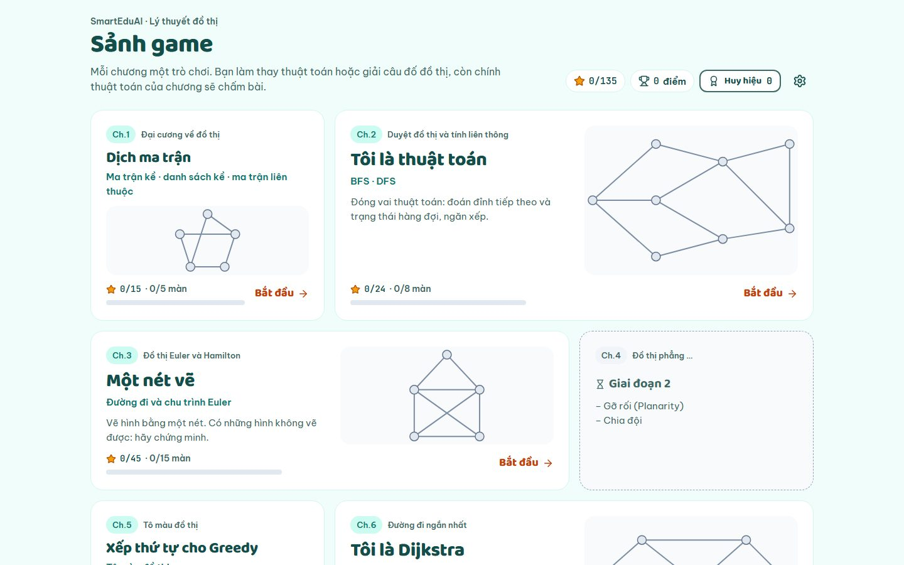

# Game hóa Lý thuyết đồ thị · SmartEduAI

Bộ game web cho môn Lý thuyết đồ thị: **6 game, 45 màn và 13 màn "Đua với máy"**, bám theo các game P0 và P0+ trong `ke-hoach-game-hoa-LTDT.md`. Trong mỗi game, sinh viên tự làm thay thuật toán hoặc giải một câu đố đồ thị. Bộ chấm chính là thuật toán của chương đó. Xong mỗi màn, sinh viên nhận sao và xem thẻ "Vì sao?" nối kết quả với định lý trong giáo trình.



| Ch. | Game | Số màn | Ưu tiên | Sinh viên làm gì |
|---|---|---|---|---|
| 1 | Dịch ma trận | 5 | P0+ | chuyển qua lại giữa hình vẽ, ma trận kề, danh sách kề và ma trận liên thuộc |
| 2 | Tôi là thuật toán (BFS/DFS) | 8 + 8 đua | P0 | dự đoán từng bước của hàng đợi và ngăn xếp |
| 3 | Một nét vẽ | 15 | P0 | vẽ một nét, hoặc chứng minh "bất khả" bằng định lý Euler |
| 5 | Xếp thứ tự cho Greedy | 4 | P0+ | xếp thứ tự đỉnh để Greedy tô màu đạt χ(G) |
| 6 | Tôi là Dijkstra | 5 + 5 đua | P0 | chọn đỉnh cố định nhãn và tự giảm nhãn |
| 7 | Thành phố bùn | 6 + 2 | P0 (+2 màn P0+) | lát đường thành cây khung nhỏ nhất, rồi xem lại Kruskal và Prim |

Chương 4 và 8 hiện trên sảnh với nhãn "Giai đoạn 2". Luật chơi, cách chấm và mục tiêu học của từng màn nằm trong [docs/GDD.md](docs/GDD.md).

## Chạy thử

Cần **Node.js 22.12 trở lên** (Vitest 5 đòi hỏi; đã thử với 22.22).

```bash
npm install
npm run dev
```

Mở http://localhost:5173/. Bản dev có sẵn **mock API điểm** ở `/api/v1`: server chấm lại bài làm, chống cộng trùng và lưu vào `.mock-data/db.json`.

Tham số trên URL (bản chạy riêng):

| Tham số | Ví dụ | Ý nghĩa |
|---|---|---|
| `user` | `?user=sv001` | id sinh viên (mặc định `sv-demo`); mỗi id có tiến độ riêng |
| `unlock=all` | `?user=gv&unlock=all` | mở mọi màn (giảng viên, kiểm thử) |
| `api` | `&api=https://…/api/v1` | dùng API điểm khác. Bản build tĩnh không có `api` thì chấm và cộng điểm ngay trong trình duyệt |
| `hint` | `&hint=https://…/hint` | dùng chatbot Socratic cho gợi ý (mặc định: gợi ý tĩnh) |

Route: `#/` (sảnh), `#/game/<gameId>`, `#/play/<levelId>` (thêm `-race` cho Đua với máy), `#/badges`, `#/settings`. Ví dụ: `http://localhost:5173/?unlock=all#/play/ch7-l06`.

## Lệnh

| Lệnh | Việc |
|---|---|
| `npm run dev` | chạy bản dev kèm mock API |
| `npm run build` | kiểm tra kiểu rồi build bản chạy riêng vào `dist/` (đường dẫn tương đối, đặt ở thư mục nào cũng chạy) |
| `npm run preview` | phục vụ `dist/` để thử bản build |
| `npm run build:embed` | build bản nhúng vào website vào `dist-embed/` ([docs/INTEGRATION.md](docs/INTEGRATION.md)) |
| `npm run typecheck` | chỉ kiểm tra kiểu TypeScript |
| `npm test` | kiểm thử đơn vị (Vitest) |
| `npm run e2e` | kiểm thử end-to-end (Playwright) trên desktop 1440 px và mobile 375 px |
| `npm run shots` | chụp sảnh và màn đầu của mỗi game (lúc chơi và lúc thắng) vào `docs/screens/` |

Trước lần chạy e2e đầu tiên:

```bash
npx playwright install chromium
npm run build:embed   # để test bản nhúng chạy trên bản build mới nhất (thiếu thì test đó bị bỏ qua)
npm run e2e
```

Playwright tự bật dev server ở cổng 5199, hoặc dùng lại server đang chạy ở cổng đó.

## Nhúng vào SmartEduAI

```js
import { mountLtdtGames } from "/static/ltdt-games/ltdt-games.js";

const app = mountLtdtGames(document.getElementById("games"), {
  userId: currentUser.id,
  courseId: "LTDT",
  apiBase: "/api/v1",
  hashRouting: false,
  authToken: () => auth.getAccessToken(),
});
```

Cần thêm `<link rel="stylesheet" href="/static/ltdt-games/ltdt-games.css">`. Đầy đủ cấu hình, hợp đồng API điểm (TV1), gợi ý Socratic (TV5), cách chấm lại ở server và cách thay mã thuật toán của nhóm: [docs/INTEGRATION.md](docs/INTEGRATION.md).

## Cấu trúc

```text
ltdt-games/
├─ index.html               trang chạy riêng
├─ src/
│  ├─ main.tsx              điểm vào khi chạy riêng (đọc ?user, ?api, ?hint, ?unlock)
│  ├─ embed.ts              điểm vào khi nhúng: mountLtdtGames, verifySubmission
│  ├─ app/                  App, cấu hình, router, GamesContext (điểm, tiến độ, âm thanh, analytics)
│  ├─ core/                 TypeScript thuần, dùng chung cho client và server
│  │  ├─ algorithms/        BFS, DFS, Dijkstra, Euler, tô màu, Kruskal và Prim
│  │  ├─ engines/           PredictionEngine cho BFS, DFS, Dijkstra
│  │  ├─ games/             luật của từng game
│  │  ├─ levels/            dữ liệu 45 màn
│  │  ├─ scoring.ts         sao và điểm
│  │  ├─ verify.ts          chấm lại bài làm (client và server gọi cùng hàm)
│  │  └─ events.ts          learning event, idempotency, điểm thưởng
│  ├─ games/<game>/         giao diện từng game và thẻ "Vì sao?"; shared/ là khung màn chơi dùng chung
│  ├─ screens/              sảnh, trang game, màn chơi, huy hiệu, cài đặt
│  ├─ services/             điểm (HTTP và cục bộ), tiến độ, huy hiệu, gợi ý, analytics, âm thanh, lưu trữ
│  └─ ui/                   CSS (token, nền tảng, bàn chơi, overlay), GraphBoard, pháo giấy, modal, toast
├─ server/mock-api.ts       mock API điểm của TV1 (chỉ chạy trong npm run dev)
├─ public/assets/           âm thanh và hình Kenney (CC0), kèm license
├─ tests/unit/              Vitest: thuật toán, engine, luật game, dữ liệu màn, chấm lại, dịch vụ
├─ tests/e2e/               Playwright: chơi hết 45 màn, các luồng, trợ năng, bố cục, nhúng, chụp ảnh
└─ docs/                    GDD, art direction, asset manifest, tích hợp, nhật ký chơi thử, ảnh chụp
```

Bàn chơi vẽ bằng React + SVG, không dùng Phaser hay canvas: đồ thị chỉ tối đa 12 đỉnh, và mỗi đỉnh, mỗi cạnh là một phần tử thật nên dùng được bằng bàn phím và trình đọc màn hình. Lý do đầy đủ ở GDD, mục 13.

## Tài liệu

| File | Nội dung |
|---|---|
| [docs/GDD.md](docs/GDD.md) | luật chơi, cách tính sao và điểm, danh sách màn, câu hỏi còn mở, nhật ký quyết định |
| [docs/ART_DIRECTION.md](docs/ART_DIRECTION.md) | phong cách hình ảnh, màu (đã đo tương phản), font, chuyển động, âm thanh |
| [docs/ASSET_MANIFEST.md](docs/ASSET_MANIFEST.md) | nguồn và license của mọi asset |
| [docs/INTEGRATION.md](docs/INTEGRATION.md) | nhúng vào website, hợp đồng API, gợi ý Socratic, thay mã thuật toán |
| [docs/PLAYTEST_LOG.md](docs/PLAYTEST_LOG.md) | các vòng chơi thử: lỗi tìm thấy, cách sửa, số đo hiệu năng |
| [docs/screens/](docs/screens/) | ảnh chụp desktop và mobile của sảnh và từng game |

## Kiểm thử

- **Đơn vị (Vitest):** thuật toán, ba engine, luật từng game, dữ liệu 45 màn (đáp án ghi trong dữ liệu phải khớp thuật toán), chấm lại bài làm, chống cộng trùng, gộp tiến độ từ server, token trên mọi request.
- **End-to-end (Playwright), desktop 1440 px và mobile 375 px:**
  - tự giải lại cả 45 màn và 13 màn đua bằng thao tác thật, kiểm tra số sao;
  - các luồng: trả lời sai, gợi ý, chơi lại không cộng trùng, mở khóa, đổi máy, xóa tiến độ;
  - trợ năng: chơi bằng bàn phím, viền focus, giảm chuyển động, tên cho mọi nút;
  - bố cục và checklist UI mục 7.5 của kế hoạch ở 375, 768, 1024 và 1440 px: vùng chạm 44 px, khoảng cách 8 px, tương phản 4.5:1, không tràn ngang;
  - nhúng vào trang chủ giả lập: CSS toàn cục không làm lệch giao diện, bản build chơi trọn một màn, request kèm token.
- Test chơi màn và test luồng thất bại nếu có lỗi console, lỗi trang hoặc phản hồi HTTP ≥ 400.

Kết quả lần chạy gần nhất ghi trong [docs/PLAYTEST_LOG.md](docs/PLAYTEST_LOG.md).

## Giới hạn đã biết

- **Nội dung:** đồ thị các màn là đồ thị tự thiết kế; số mục trích dẫn giáo trình trong thẻ "Vì sao?" cần giảng viên đối chiếu (GDD, câu hỏi 6–7).
- **Chưa nối hệ thống thật:** API điểm (TV1) và chatbot (TV5) mới chạy qua mock. Bản build tĩnh không có `api` thì chấm điểm ngay trong trình duyệt: sinh viên sửa được localStorage, nên chỉ dùng để demo.
- **Mock API không có xác thực** và lưu vào một file JSON: không dùng cho môi trường thật.
- **Server không kiểm được** số lần dùng gợi ý và thời gian của chế độ đua: hai số này do client báo (GDD, câu hỏi 8).
- **Sự kiện rời trang** (`game_level_abandoned`) gửi bằng `sendBeacon`, không mang được header `Authorization` (GDD, câu hỏi 11).
- **Âm thanh:** file OGG Vorbis. Safari đời cũ không giải mã được thì game tự chuyển sang âm tổng hợp bằng Web Audio.
- **Chương 4 và 8** chưa có game (giai đoạn 2 của kế hoạch).
- **Chỉ kiểm thử trên Chromium:** desktop và giả lập Pixel 7 ở 375 px. Chưa thử trên Safari, Firefox hay điện thoại thật.
- **Tương phản chữ bên trong SVG** (nhãn đỉnh, trọng số, thẻ giá) chưa được đo tự động; checklist chỉ đo chữ HTML.
- **CSS của trang chủ** có selector mạnh hơn một class hoặc `!important` vẫn có thể lọt vào game; khi đó dùng iframe ([INTEGRATION](docs/INTEGRATION.md), mục 2.6).
- **Máy yếu:** ở CPU chậm 4× (giả lập), lúc hộp kết quả hiện ra có một khung hình khựng khoảng 150–170 ms. Desktop giữ 60 fps.
- **Mở game ở hai tab cùng lúc:** tab ghi sau đè tiến độ trên máy của tab kia. Có API thì lần mở sau gộp lại từ server.

## Ghi công

Hình và âm thanh: [Kenney](https://kenney.nl) (CC0). Font: Baloo 2, Be Vietnam Pro, JetBrains Mono (SIL OFL 1.1, tự host qua @fontsource). Icon: [Lucide](https://lucide.dev) (ISC). Chi tiết trong [docs/ASSET_MANIFEST.md](docs/ASSET_MANIFEST.md) và ở màn hình Cài đặt → Ghi công.
